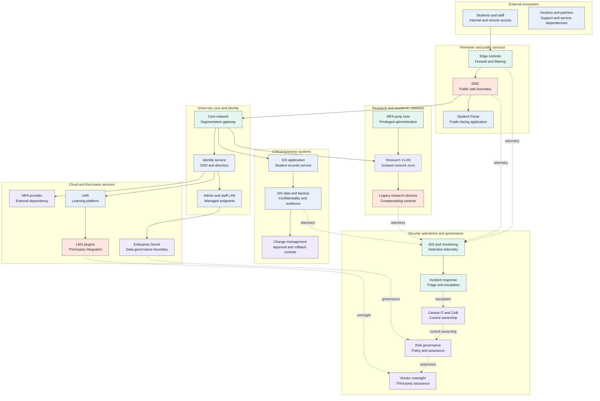
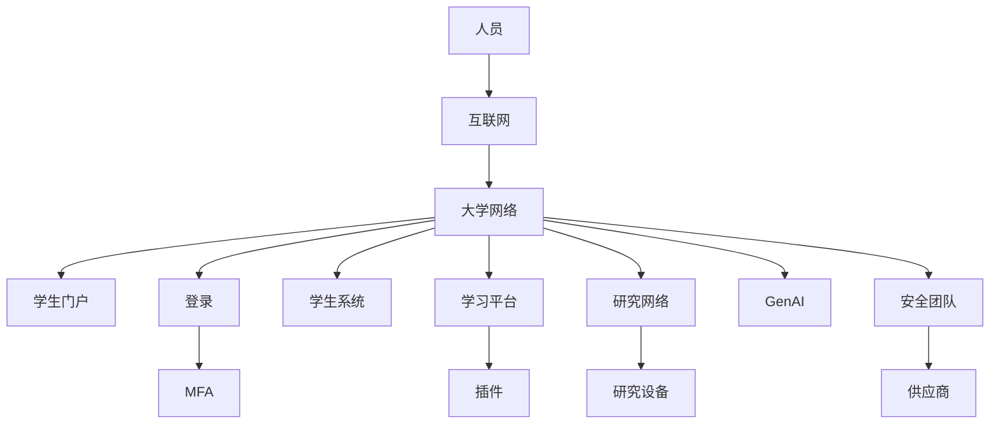
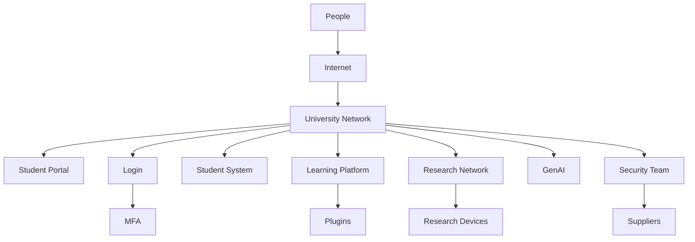

# Torridge University — Conceptual Security Topology

> Sanitised architecture view for Assessment 2. It contains no real IP addresses, credentials, configuration values, raw logs, or original evidence files. Connections and control status must be validated against approved private records before operational use.

## Reading guide

- Solid arrows show primary service or access paths.
- Dotted arrows show monitoring, escalation, governance, or assurance relationships.
- Dashed boundaries are logical trust zones, not a verified configuration diagram.
- High-exposure components require specific validation of segmentation, access control, patching, vendor assurance, and compensating controls.

## 简化版拓扑图

## Simplified Topology (English)

